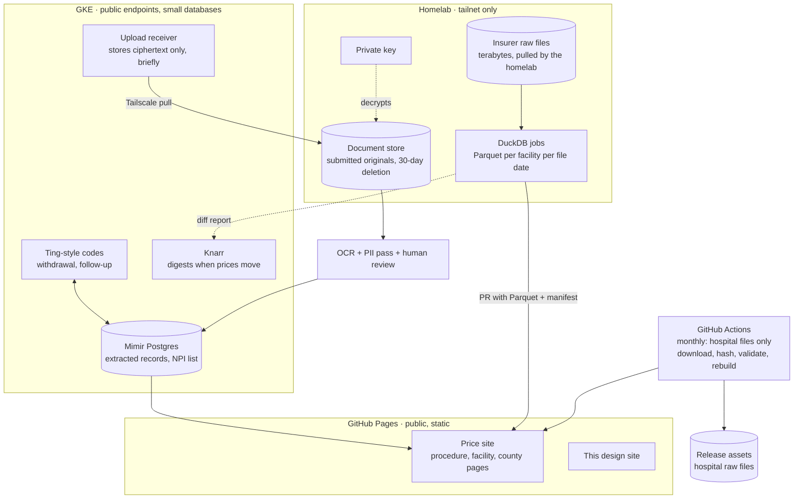

# System overview

Three tiers, each holding only what it must.

## GitHub Pages

Everything static and public: the price site and this design site. Built by GitHub Actions from committed derived JSON or from release assets when the JSON outgrows the repository. No server-side code, no analytics beyond server-side counts at most.

## GitHub Actions

Actions touches the **hospital** files only: small, public, and served from the hospitals' own sites. The monthly job downloads each file, records URL, SHA-256, and date in `data/manifest.json`, runs the validator, attaches the raw file to a release, rebuilds the derived JSON, and commits. Actions never reaches the tailnet and never sees an insurer file or a submitted document.

## GKE

Anything that needs a public endpoint or a database and holds no health document in readable form: the Ting-style code service, the upload receiver, Knarr for outbound digests, and a Mimir Postgres claim for the structured extracted records and the Essex NPI list. The receiver stores only ciphertext, encrypted on the resident's device to a public key whose private half exists only on the homelab, and holds it until the homelab pulls it over the tailnet and the copy is deleted. See [Intake path](intake.md).

What a compromise of the cluster exposes, stated separately: queued uploads stay ciphertext, so no document is readable; the Ting-style code records and the structured extracted records in Postgres are readable, and both are designed to carry nothing that identifies a household (codes are tied to records, not people; extracted records are the public data minus anything suppressed). The receiver's encryption protects documents, not the databases.

## Homelab

Reachable only over Tailscale. The homelab **pulls** the terabyte insurer files on its own schedule from the carriers' public URLs, runs the DuckDB jobs, holds the document store with its deletion schedule and the private key, and pushes results outward as a pull request carrying Parquet, derived JSON, and manifest entries, using a token scoped to that repository. Nothing on it accepts inbound connections from the internet. Until the large box exists, any current k8s node in the house can run the receiver's pull side and the Layer A jobs; only Layer B needs the disks.

## Proving the shape before the data

Milestone M0.5 runs this topology end to end with a dummy file and no real data: a form on GKE accepts a file encrypted in the browser, a homelab job pulls and decrypts it over the tailnet, writes a one-row Parquet, opens the pull request, and a Pages build renders it. It asserts three things besides the happy path: the receiver's ciphertext is gone after the pull; the stored original is deleted when its retention clock expires, tested with the clock shortened to minutes; and the receiver's deployed configuration and image contain the public key and nothing that could decrypt (where the private key lives is a custody question for the homelab, not something a spike can prove). No gigabytes, no health documents. It proves the hop, the key handling, the deletion, and the build trigger, which are the parts most likely to be wrong.

## Open

- Whether the GKE receiver is worth a service of its own or whether Ting grows an upload endpoint; see [Integrations](integrations.md).
- Key custody and rotation for the homelab private key.
- Whether Pages builds pull derived JSON from the repository or from release assets; depends on size after M2.
- The homelab's repository token scope and how its pull requests are reviewed before merge.
