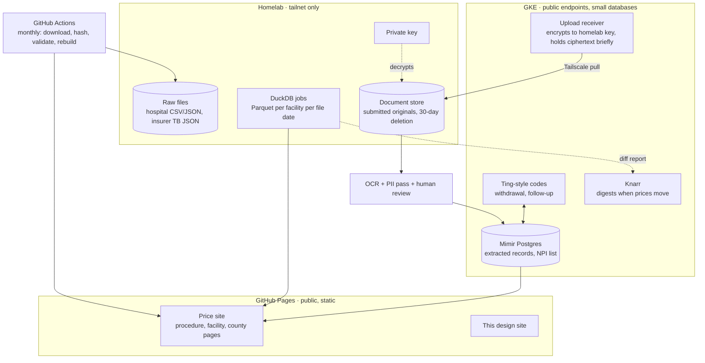

# System overview

Three tiers, each holding only what it must.

## GitHub Pages

Everything static and public: the price site and this design site. Built by GitHub Actions from committed derived JSON or from release assets when the JSON outgrows the repository. No server-side code, no analytics beyond server-side counts at most.

## GKE

Anything that needs a public endpoint or a database and holds no health document in readable form: the Ting-style code service, the upload receiver, Knarr for outbound digests, and a Mimir Postgres claim for the structured extracted records and the Essex NPI list. The receiver encrypts each upload to a public key whose private half exists only on the homelab, holds the ciphertext until the homelab pulls it over the tailnet, then deletes it. A compromise of the cluster yields ciphertext.

## Homelab

Reachable only over Tailscale. The terabyte insurer files, the DuckDB jobs, the document store with its deletion schedule, and the private key. Nothing on it is exposed to the internet. Until the large box exists, any current k8s node in the house can run the receiver side and the Layer A jobs; only Layer B needs the disks.

## Proving the shape before the data

Milestone M0.5 runs this topology end to end with a dummy file and no real data: a form on GKE accepts a file, encrypts it, a homelab job pulls and decrypts it over the tailnet, writes a one-row Parquet, and a Pages build renders it. No gigabytes, no health documents. It proves the hop, the key handling, the deletion, and the build trigger, which are the parts most likely to be wrong.

## Open

- Whether the GKE receiver is worth a service of its own or whether Ting grows an upload endpoint; see [Integrations](integrations.md).
- Key custody and rotation for the homelab private key.
- Whether Pages builds pull derived JSON from the repository or from release assets; depends on size after M2.
