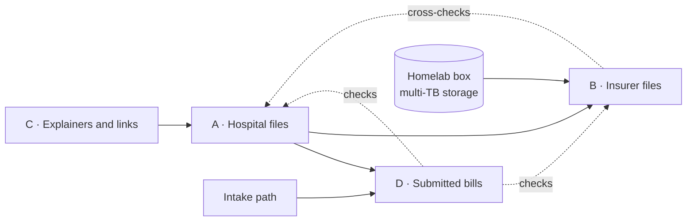

# The four layers

The work splits into four layers by data source. They are lettered by the order they were first thought of and built in the order that gets a useful site soonest.

| Layer | What | Source | Order |
|---|---|---|---|
| [C](c-explainers.md) | Explainers and curated links | Existing publishers, Medicare lookups, the state facility search | First |
| [A](a-hospital-files.md) | Hospital negotiated and cash prices | Each hospital's CMS-template machine-readable file (45 CFR Part 180) | Second |
| [D](d-submitted-bills.md) | Submitted bills: what residents were billed and what their plans paid, as reported | Residents' explanations of benefits and itemized bills, redacted | A trickle from near the start; grows with the audience |
| [B](b-insurer-files.md) | Insurer in-network rates for every Essex provider, including freestanding imaging and surgery centers | Each carrier's Transparency in Coverage in-network files | When the homelab box is ready |

## Why this order

**C costs almost nothing** and is a plain site element: a page of where else to look and a handful of explainers. It frames everything that follows and is the first thing a reader can use.

**A is small, public, and answers the Brown table's question with actual dollars.** Seven files, one per hospital, in a known template.

**D needs an audience and a privacy design**, but a trickle early builds the habit, and contributing is itself an outlet for people who are angry and have nowhere to put it. Its records are the check on A and B.

**B is the layer that makes the site unique**: the hospital department beside the freestanding center for the same scan and the same insurer. It is also the heavy one, measured in terabytes per carrier per month, so it is gated on hardware, not on the rule. The October 2026 final rule (CMS-9882-F) consolidates files per network, removes ghost rates, and moves to quarterly posting under a new schema from April 1, 2027; the current files are usable now given disk and bandwidth, and the parser written for them is disposable by design.

## Open

- Whether submitted bills from outside Essex are accepted from the start. Proposal: yes, published once a county has its own facility list.
