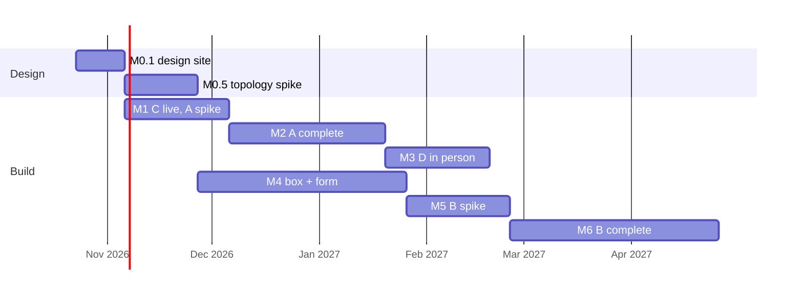

# Milestones

| Milestone | What | Depends on |
|---|---|---|
| **M0** | Design v0 written. Done 2026-10-22. | |
| **M0.1** | This design site, with the research list distributed to its pages and [Sources and projects](../reference/sources.md) researched. | |
| **M0.5** | Topology spike: a dummy file through GKE receiver → Tailscale → homelab → Parquet → Pages build. No real data, no gigabytes. Proves the encrypted hop, key handling, deletion, and build trigger. | A current homelab node, Tailscale, a GKE namespace |
| **M1** | Layer C live: Sources and projects, the first explainers, the methods page. Layer A spike: one hospital, ten codes, one procedure page rendered from a Parquet file. The price site's generator decided. | M0.1 |
| **M2** | Layer A for all seven hospitals and the full code list, with benchmarks, facility pages, the county overview, and the methods page. The yearly county table lands on the ledger's services page. | M1, research on facilities, codes, benchmark |
| **M3** | Layer D instructions page, consent text, and in-person intake; first submissions processed by hand. | Redaction research, counsel on HIPAA reading |
| **M4** | Homelab box online with storage; the receiver and the form open. | M0.5, hardware |
| **M5** | Layer B spike: one carrier, one network, Essex NPIs only, merged into the procedure pages. | M4, parser evaluation |
| **M6** | Layer B for all major carriers; the hospital-versus-insurer cross-check published. | M5 |
| **M7** | A second county runs the pipeline from its own configuration. | M2 at least |

The dates on the chart are durations for shape, not commitments. The one external gate is hardware for M4; everything before it runs on what exists.

## Open

- When the homelab box is bought, and its spec (fast NVMe scratch and cores over RAM).
